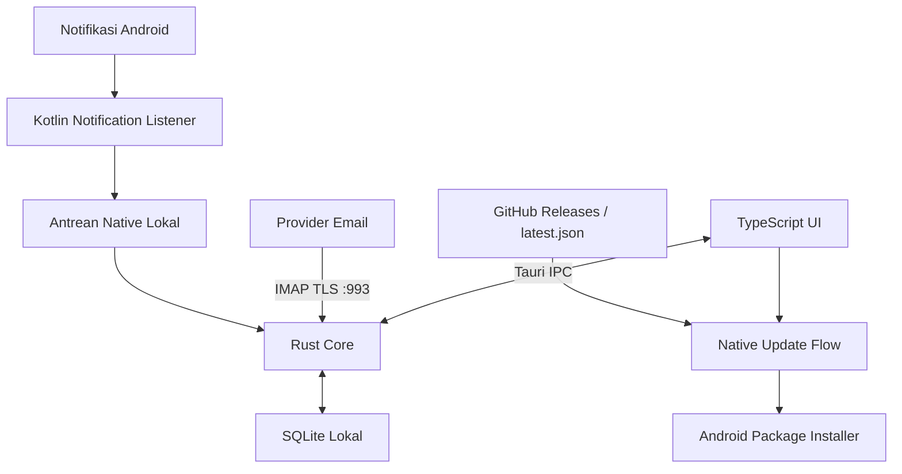

<div align="center">


# Arus

### Local-First Personal Finance & Expense Tracker for Android

Keuangan lebih tertata. Data tetap milik Anda.

[](https://github.com/Xeron23/arus/releases)
[](#lisensi)


[**Download APK v0.3.1**](https://github.com/Xeron23/arus/releases/download/v0.3.1/arus-release.apk)
· [Semua Rilis](https://github.com/Xeron23/arus/releases)
· [Laporkan Masalah](https://github.com/Xeron23/arus/issues)

</div>

---

## Tentang Arus

**Arus** adalah aplikasi pencatatan keuangan personal untuk Android, dibangun dengan **Tauri v2, TypeScript, Rust, dan SQLite**.

Kelola rekening bank, e-wallet, dan uang tunai dalam satu aplikasi. Impor transaksi dari email melalui koneksi IMAP langsung, tangkap notifikasi transaksi Android, dan tinjau catatan keuangan melalui inbox audit.

### 100% Local-First & Zero Cloud

Data finansial diproses dan disimpan secara lokal pada perangkat. Tidak ada backend developer untuk menerima transaksi, isi email, atau database keuangan Anda.

Koneksi email berlangsung langsung antara perangkat dan provider email. Pengecekan pembaruan menghubungi GitHub untuk mengambil informasi rilis dan APK.

> **Zero Cloud berarti tidak ada penyimpanan atau pemrosesan data finansial di server developer.** Sinkronisasi email dan download pembaruan tetap membutuhkan internet.

### 100% Gratis & Bebas Biaya API

Arus tidak menggunakan agregator finansial berbayar seperti **Brick, Plaid, atau SNAP BI**. Tidak diperlukan API key agregator untuk mencatat transaksi dari email maupun notifikasi.

Penggunaan internet tetap mengikuti biaya koneksi masing-masing pengguna.

## Fitur Unggulan

| Fitur | Deskripsi |
|---|---|
| **Multi-Wallet** | Kelola BCA, Mandiri, GoPay, OVO, DANA, dan Kas Tunai sebagai dompet terpisah. Tambahkan dompet sesuai kebutuhan. |
| **Real IMAP Sync** | Hubungkan Gmail, Yahoo, Outlook, atau custom IMAP melalui TLS port **993**, sesuai metode autentikasi yang didukung provider. |
| **Read-Only Email Fetch** | Pengambilan email menggunakan `BODY.PEEK`, sehingga sinkronisasi tidak menandai pesan sebagai sudah dibaca. |
| **Android Notification Listener** | Tangkap notifikasi transaksi dari aplikasi yang didukung, termasuk GoPay, DANA, OVO, dan pembayaran QRIS. |
| **Two-Layer Deduplication** | Cegah impor email berulang melalui identitas pesan dan cegah pencatatan ulang transaksi melalui referensi transaksi bank. |
| **Review & Audit Inbox** | Tinjau cuplikan bukti email, periksa format yang belum dikenali, koreksi kategori, konfirmasi transaksi, dan lakukan Undo. |
| **In-App Auto-Updater** | Periksa rilis terbaru melalui `latest.json`, download APK, lalu konfirmasi pemasangan melalui installer Android. |
| **Pencatatan Manual** | Catat transaksi yang tidak memiliki email atau notifikasi, termasuk pengeluaran tunai. |
| **Rekonsiliasi Dompet** | Bandingkan saldo tercatat dengan saldo aktual untuk membantu menemukan selisih. |

### Dua lapisan deduplikasi

1. **Identitas email** — memakai `Message-ID`, dengan fallback SHA-256 dari pesan ketika `Message-ID` tidak tersedia. Identitas IMAP juga membantu mengenali pesan yang sudah diimpor.
2. **Referensi transaksi** — memeriksa referensi transaksi berdasarkan dompet dan bank agar transaksi yang sama tidak dicatat ulang.

Deduplikasi berbasis referensi bergantung pada kelengkapan informasi sumber. Penggabungan transaksi dari email dan notifikasi tidak boleh dianggap selalu otomatis.

### Parsing yang dapat ditinjau

Format email dan notifikasi berbeda antarbank, aplikasi, serta versi layanan. Dukungan provider email tidak berarti semua format mutasi atau lampiran e-statement sudah dapat diparsing.

Format email yang ambigu atau belum dikenali perlu diperiksa melalui inbox audit. Tetap bandingkan hasil pencatatan dengan mutasi resmi.

## Instalasi Android

### Download

| File | Kegunaan |
|---|---|
| [**arus-release.apk — v0.3.1**](https://github.com/Xeron23/arus/releases/download/v0.3.1/arus-release.apk) | Build release untuk penggunaan harian |
| [arus-debug.apk — v0.3.1](https://github.com/Xeron23/arus/releases/download/v0.3.1/arus-debug.apk) | Build debug untuk pengembangan dan diagnosis |
| [Catatan rilis v0.3.1](https://github.com/Xeron23/arus/releases/tag/v0.3.1) | Informasi rilis dan seluruh asset |

**Minimum Android:** Android 7.0 / API 24. Gunakan APK yang sesuai dengan arsitektur perangkat.

### Cara memasang APK

1. Download **`arus-release.apk`** dari link di atas.
2. Buka APK melalui browser atau aplikasi Files.
3. Jika diminta, izinkan **Install unknown apps / Instal aplikasi tidak dikenal** untuk aplikasi yang membuka APK.
4. Kembali ke layar pemasangan dan tekan **Install**.
5. Buka Arus dan mulai menambahkan dompet atau menghubungkan email.

Nama menu dapat berbeda tergantung versi Android dan produsen perangkat.

> Download hanya dari repository dan halaman rilis resmi. Jika mengunduh ZIP artifact GitHub Actions, ekstrak terlebih dahulu lalu pasang file `.apk` di dalamnya.

### Memperbarui aplikasi

Buka **Pengaturan → Periksa Pembaruan**, lalu ikuti proses download dan konfirmasi instalasi Android.

Update memerlukan application ID dan signing certificate yang kompatibel dengan aplikasi terpasang. Hindari uninstall sebagai langkah pembaruan karena tindakan tersebut dapat menghapus database lokal.

## Menghubungkan Gmail

Arus menggunakan **Google App Password**, bukan password utama akun Google.

1. Aktifkan [Verifikasi 2 Langkah Google](https://myaccount.google.com/security).
2. Buka [Google App Passwords](https://myaccount.google.com/apppasswords).
3. Buat App Password dengan nama yang mudah dikenali, misalnya **Arus**.
4. Di Arus, buka **Pengaturan → Hubungkan Email**.
5. Masukkan alamat Gmail dan App Password **16 karakter**.
6. Pilih dompet default, lalu tekan **Test Connection**.
7. Setelah berhasil, simpan akun dan jalankan **Sync**.
8. Periksa hasil impor di **Review & Audit Inbox**.

**Pengaturan Gmail:**

| Parameter | Nilai |
|---|---|
| Host | `imap.gmail.com` |
| Port | `993` |
| Keamanan | Implicit TLS |
| Username | Alamat Gmail lengkap |
| Password | Google App Password |

App Password mungkin tidak tersedia untuk akun dengan kebijakan organisasi atau konfigurasi keamanan tertentu.

### Penyimpanan kredensial

App Password disimpan sementara dalam memori Rust selama sesi, bukan dipersistenkan ke SQLite atau localStorage. Setelah aplikasi benar-benar ditutup, pengguna perlu membuka kembali sesi email dengan App Password.

Jangan membagikan App Password melalui issue, screenshot, atau log. Cabut App Password melalui akun Google jika sudah tidak digunakan.

### Provider email lain

Yahoo, Outlook, dan custom IMAP dapat digunakan jika provider mengizinkan metode autentikasi yang tersedia di Arus.

**OAuth2 belum diimplementasikan.** Akun yang mewajibkan OAuth2 dan menolak LOGIN/App Password tidak dapat dihubungkan melalui alur ini.

## Mengaktifkan Notification Listener

1. Buka pengaturan fitur notifikasi di Arus.
2. Masuk ke halaman **Notification Access / Akses Notifikasi** Android.
3. Izinkan akses untuk Arus.
4. Aktifkan pencatatan notifikasi di aplikasi.
5. Pastikan notifikasi transaksi dari aplikasi sumber juga aktif.

Listener menangkap notifikasi yang diposting oleh aplikasi sumber. Ketersediaan isi notifikasi bergantung pada pengaturan Android, kebijakan perangkat, dan aplikasi bank atau e-wallet.

**Batasan:**

- Tidak dapat membaca transaksi yang tidak menghasilkan notifikasi.
- Tidak menggantikan mutasi resmi bank.
- Pembatasan background, force-stop, atau penghematan baterai dapat memengaruhi penerimaan.
- QRIS adalah metode pembayaran; arah dan nominal transaksi tetap perlu dikenali dari isi notifikasi.
- Android dapat meminta langkah tambahan untuk mengaktifkan akses sensitif pada aplikasi hasil sideload.

## Arsitektur

Arus memisahkan antarmuka, logika keuangan, dan integrasi native:



### Tech Stack

| Lapisan | Teknologi | Fungsi |
|---|---|---|
| Antarmuka | Vanilla TypeScript | Navigasi, formulir, transaksi, pengaturan |
| Styling | Tailwind CSS + CSS | Tampilan mobile dan tema |
| Frontend Tooling | Vite | Development server dan bundling |
| App Runtime | Tauri v2 | Webview Android dan IPC native |
| Core | Rust | Logika keuangan, IMAP, parser, validasi |
| Database Native | SQLite | Penyimpanan lokal aplikasi |
| Android Integration | Kotlin | Notification Listener dan installer APK |
| Browser Preview | IndexedDB + mock adapter | Simulasi UI tanpa koneksi native |
| Frontend Tests | Vitest | Pengujian logika frontend |
| Core Tests | Cargo Test | Pengujian core Rust |
| CI/CD | GitHub Actions | Build dan distribusi APK |
| Distribusi | GitHub Releases | APK dan manifest pembaruan |

### Struktur Repository

```text
arus/
├── .github/workflows/             # Pipeline build Android
├── docs/                         # Arsitektur dan laporan pengujian
├── scripts/                      # Persiapan Android dan tooling
├── src/
│   ├── main.ts                   # Event dan alur UI
│   ├── models.ts                 # Kontrak tipe
│   ├── native/
│   │   ├── client.ts             # Adapter IPC native
│   │   └── mock.ts               # Simulasi browser
│   └── ui/                       # Template dan ikon
├── src-tauri/
│   ├── core/                     # Database, IMAP, parser, domain
│   ├── src/                      # Command Tauri dan integrasi
│   ├── capabilities/             # Capability aplikasi
│   └── tauri.conf.json
├── tauri-plugin-notification-listener/
│   ├── android/                  # Service dan integrasi Android
│   └── src/                      # Bridge plugin Rust
├── tests/
└── package.json
```

## Development & Build

### Prasyarat

**Browser preview:**

- Node.js **22+**
- npm

**Android native:**

- Rust stable yang memenuhi kebutuhan dependency; core membutuhkan minimal Rust **1.88**
- Android Studio
- Android SDK, Build-Tools, Platform-Tools, dan Command-line Tools
- Android NDK side-by-side; NDK r28+ disarankan
- JDK/JBR yang kompatibel
- Perangkat dengan USB debugging atau emulator Android

Atur `JAVA_HOME`, `ANDROID_HOME`, dan `NDK_HOME` sesuai instalasi lokal.

### Clone repository

```bash
git clone https://github.com/Xeron23/arus.git
cd arus
npm ci
```

### Browser / Mock Mode

```bash
npm run dev
```

Buka alamat lokal yang ditampilkan Vite, biasanya:

```text
http://localhost:1420
```

Mode browser memakai mock adapter dan IndexedDB untuk mencoba antarmuka.

**Browser tidak menjalankan IMAP native, Notification Listener Android, atau instalasi APK.** Data browser terpisah dari database aplikasi native.

### Android Native Development

Tambahkan target Rust sesuai perangkat. Contoh untuk Android ARM64:

```bash
rustup target add aarch64-linux-android
```

Inisialisasi project Android:

```bash
npm run android:init
```

Jalankan pada perangkat atau emulator:

```bash
npm run android:dev
```

Untuk development melalui perangkat fisik, pastikan perangkat dapat menjangkau dev server Vite.

### Build Debug APK

```bash
npm run android:build
```

Script membangun APK dengan mode debug.

### Build Release APK

```bash
npm run android:release
```

Build release untuk distribusi memerlukan signing keystore yang dikonfigurasi dengan benar.

Output APK berada di bawah:

```text
src-tauri/gen/android/app/build/outputs/apk/
```

Subdirektori dan nama file mengikuti ABI serta build variant.

**Jangan commit private keystore, password signing, atau kredensial email.** Gunakan GitHub Actions Secrets untuk kebutuhan CI.

### Pengujian

```bash
# Frontend tests
npm test

# Rust core tests
npm run test:rust

# Type checking dan frontend production build
npm run build
```

Pengujian browser dan unit test tidak menggantikan pengujian perangkat fisik untuk TLS IMAP, akses notifikasi, dan instalasi update.

## Privasi & Keamanan

- Database keuangan berada di perangkat pengguna.
- Tidak ada server developer yang menerima data finansial.
- IMAP terhubung langsung ke provider melalui TLS.
- Sinkronisasi email memakai `BODY.PEEK`.
- App Password tidak dipersistenkan oleh alur sesi email.
- Akses notifikasi diberikan dan dapat dicabut melalui pengaturan Android.
- Pengecekan pembaruan menghubungi GitHub untuk metadata rilis dan download APK.

**Local-first tidak berarti database otomatis terenkripsi.** Keamanan data juga bergantung pada keamanan perangkat, akses sistem, serta pengelolaan backup pengguna.

Sebelum melaporkan masalah, hapus nama pemilik akun, nomor rekening, saldo, alamat email, token, dan kredensial dari bukti yang dibagikan.

## Troubleshooting

| Masalah | Langkah awal |
|---|---|
| APK tidak dapat dipasang | Download ulang APK resmi; periksa kompatibilitas perangkat dan konflik certificate dengan versi terpasang. |
| Gmail gagal terhubung | Gunakan App Password, periksa Verifikasi 2 Langkah dan akses IMAP. |
| Outlook gagal autentikasi | Periksa apakah akun mewajibkan OAuth2 yang belum didukung Arus. |
| Notifikasi tidak tercatat | Periksa Notification Access, toggle capture, notifikasi aplikasi sumber, dan pembatasan background. |
| Email masuk review | Periksa nominal, tanggal, dompet, kategori, dan referensi transaksi sebelum konfirmasi. |
| Update gagal | Periksa koneksi, ruang penyimpanan, izin instalasi, serta kompatibilitas signing certificate. |

Laporkan masalah melalui [GitHub Issues](https://github.com/Xeron23/arus/issues) dengan versi Arus, versi Android, model perangkat, dan langkah reproduksi yang sudah disamarkan.

## Kontribusi

Kontribusi berupa perbaikan bug, pengujian perangkat, peningkatan aksesibilitas, dan dukungan format transaksi baru sangat membantu.

1. Buat issue untuk perubahan besar.
2. Buat branch untuk perubahan Anda.
3. Jalankan pengujian yang relevan.
4. Sertakan penjelasan perubahan dan cara verifikasi pada pull request.

Untuk kontribusi parser, gunakan fixture sintetis atau data yang sudah dianonimkan. Jangan mengunggah email maupun notifikasi finansial asli yang memuat data pribadi.

## Dokumentasi

- [Arsitektur](./docs/ARCHITECTURE.md)
- [Laporan Pengujian](./docs/TEST_REPORT.md)
- [Rilis dan APK](https://github.com/Xeron23/arus/releases)
- [Issues](https://github.com/Xeron23/arus/issues)

## Lisensi

Repository ini belum menyertakan file `LICENSE`. Ketersediaan source code secara publik tidak otomatis memberikan lisensi penggunaan, modifikasi, atau distribusi ulang.

Ketentuan lisensi akan mengikuti file `LICENSE` setelah ditetapkan oleh pemilik repository. Dependency pihak ketiga tetap mengikuti lisensinya masing-masing.

## Disclaimer

Arus adalah alat bantu pencatatan keuangan pribadi, bukan layanan perbankan, penasihat keuangan, atau sumber mutasi resmi.

Arus tidak berafiliasi dengan BCA, Bank Mandiri, GoPay, OVO, DANA, Google, Microsoft, Yahoo, maupun penyedia layanan lain yang disebutkan. Nama dan merek merupakan milik pemegangnya masing-masing.

Hasil parsing dapat tidak lengkap atau keliru ketika format sumber berubah. Verifikasi transaksi penting terhadap catatan resmi bank atau e-wallet, dan lindungi data lokal sebelum uninstall atau mengganti perangkat.

---

<div align="center">

**Arus — Keuangan lebih tertata. Data tetap milik Anda.**

[Download Android](https://github.com/Xeron23/arus/releases/download/v0.3.1/arus-release.apk)
· [GitHub](https://github.com/Xeron23/arus)
· [Laporkan Masalah](https://github.com/Xeron23/arus/issues)

</div>
