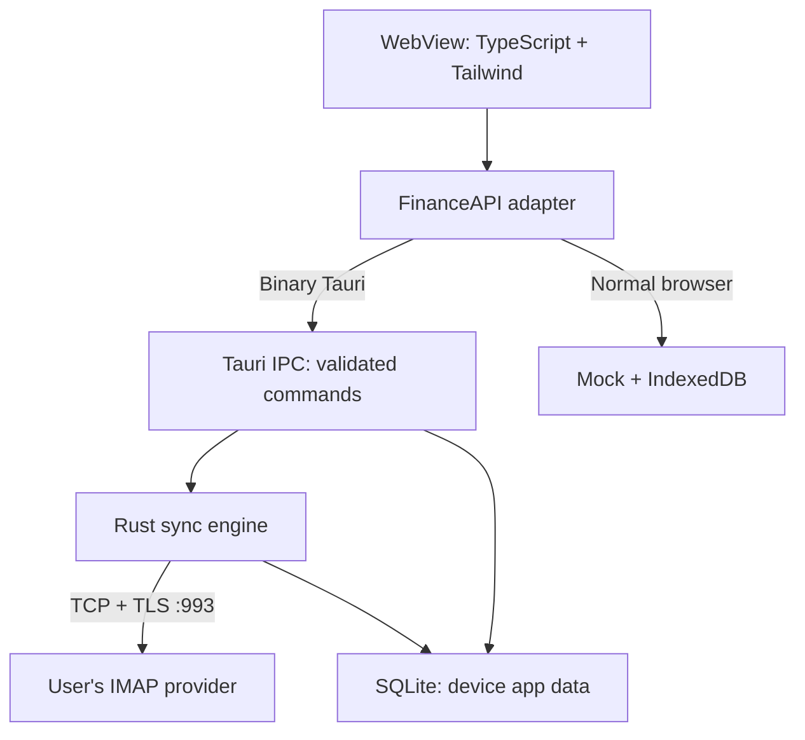

# Arus local architecture

Tidak ada developer backend. IPC bukan HTTP server dan tidak mengirim data ke cloud pengembang. Vite hanya untuk pengembangan. Production JS hanya mengakses IPC; TLS IMAP dilakukan oleh Rust di luar browser networking.

## Native commands

| Command | Input | Output / action |
|---|---|---|
| init_database / get_snapshot | None | Wallets, ledger, email audit, account metadata, theme |
| test_imap_connection | ConnectionInput | TLS/auth/examine report; no persisted secret |
| save_email_account | ConnectionInput + wallet + autoPost | Reverify TLS/auth, save metadata, retain session secret |
| unlock_email_account | accountId + password | Verify and open in-memory session |
| lock_email_account | accountId | Drop/zeroize session password |
| sync_email_transactions | optional accountId + Channel | Progress and SyncReport; max 200 per account |
| save_manual_transaction | EntryInput | Atomic ledger insert |
| delete_transaction | id + undo | Soft-delete / undo |
| resolve_review | emailId + action + corrected entry | Atomic email + ledger update |
| undo_review | emailId | Return to review and reverse ledger effect |
| upsert_wallet | WalletInput | Create/update initial balance metadata |
| reconcile_wallet | id + observed + adjust | Save observed; optional explicit adjustment |
| update_email_account | AccountUpdate | Mapping, enabled, auto-post |
| set_theme | light/dark | Persist local theme |

Arguments sent through invoke use camelCase; struct fields use serde rename_all camelCase. No command returns a saved password or accepts raw SQL/filesystem paths from JavaScript. SQLite path is determined by Rust app_data_dir(). All SQL user values are bound parameters. A secret is passed through IPC only when the user submits Test, Connect or Unlock.

## Crash and retry boundary

1. Read per-folder UIDVALIDITY and local cursor.
2. Search UID greater than cursor, sorted ascending.
3. Fetch size, then BODY.PEEK body / bounded prefix.
4. Parse MIME and choose review/posted/ignored/error.
5. SQLite BEGIN IMMEDIATE → dedup → email → optional ledger → cursor → audit log → COMMIT.
6. Only committed UIDs are considered processed. A dropped network connection leaves previously committed emails intact.

A poisoned session is dropped on error, not reused. User retry creates a new TLS session. Partial sync results include warnings and the UI reloads the persisted ledger. There is no retry loop for authentication failures.

## Money and provenance

INTEGER amounts, not float; frontend rejects non-integer and unsafe values. Transfers share one ledger row with source and destination wallets. Monthly analytics count only expense/income kinds. Email receipt time comes from INTERNALDATE; actual transaction time comes from parsed bank text or user correction. Evidence is displayed through escaped text, never innerHTML sourced from email content.

## Schema and state

`schema.sql` is the initial v1 schema. Foreign keys, WAL, five-second busy timeout, unique message and reference indexes, explicit transactions, and audit_log are enabled. Future schema evolution must add ordered migrations; increasing PRAGMA user_version alone is not a migration implementation. Runtime data are outside project source. Credentials are in Rust memory only; SQLite is standard unencrypted SQLite.

